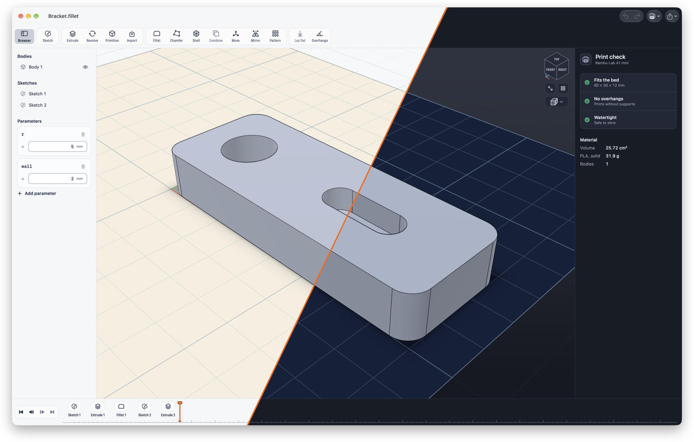

# Fillet

Offline, parametric CAD for 3D-printable parts — native SwiftUI for iPad and Mac,
built on the OpenCascade 8 geometry kernel. Design with sketches and features on a
Fusion-style timeline, save as a normal `.fillet` file (Files / iCloud Drive), and
export 3MF for Bambu Studio.



## Build

Requirements: Xcode 27, CMake (`brew install cmake`), XcodeGen (`brew install xcodegen`).

```sh
scripts/build-occt.sh          # once: builds OpenCascade for macOS, iOS and the iOS simulator (~30 min)
swift test                     # kernel, core and viewport tests
cd App && xcodegen generate    # creates App/Fillet.xcodeproj
open Fillet.xcodeproj          # pick the Fillet scheme, a Mac or your iPad, Run
```

To run on an iPad, put your team in `App/Local.xcconfig` (gitignored): `DEVELOPMENT_TEAM = ABCDE12345`.
A team picked under *Signing & Capabilities* is lost on the next `xcodegen generate`; this one isn't.

## Layout

| Path | What |
|---|---|
| `Sources/CFilletKernel` | C++ bridge to OpenCascade behind a small C API (`include/FilletKernel.h`) |
| `Sources/FilletKernel` | Swift wrapper: `Shape`, `SketchRegions`, `Mesh`, geometry types |
| `Sources/FilletCore` | Document model, expressions & parameters, sketch shapes & tools, persistent references, recompute engine, print analysis, 3MF/STL export |
| `Sources/FilletViewport` | Metal renderer, camera, picking, touch/Pencil/mouse input |
| `App/` | The SwiftUI app (XcodeGen `project.yml`) |
| `docs/design.md` | Design and architecture |
| `docs/icon/` | App icon sources (`build.sh` regenerates everything) |

## End-to-end check (Mac)

A debug build can drive a full workflow (sketch → extrude → fillet → sketch on
face → pocket → parametric change → export) through the real UI code paths and
snapshot every step:

```sh
FILLET_AUTOMATION=1 build/dd/Build/Products/Debug/Fillet.app/Contents/MacOS/Fillet
# results: ~/Library/Containers/app.fillet.Fillet/Data/tmp/fillet-automation/
```
